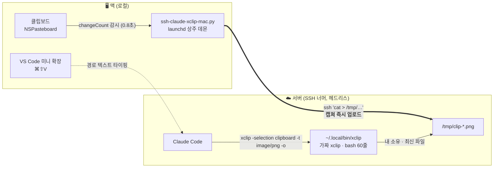
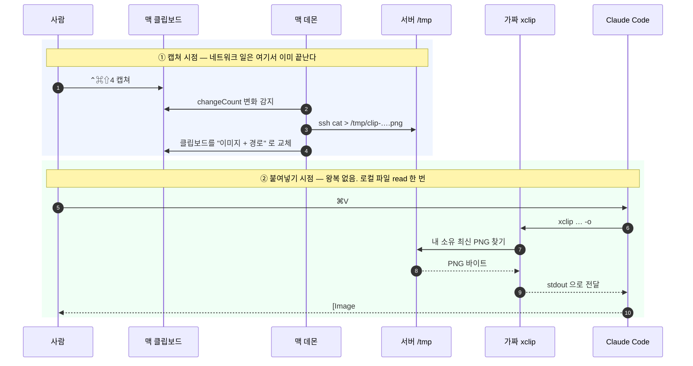
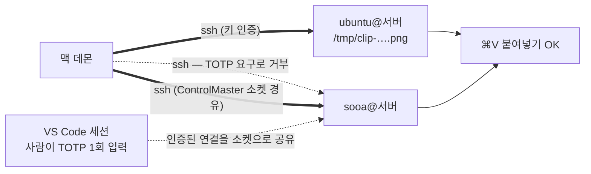

# ssh-claude-xclip — 동작 원리

설치·사용법은 [README.md](README.md) 참고. 이 문서는 내부 구조, 검증, 트러블슈팅.

## 구조



서버로 들어가는 선은 **평범한 아웃바운드 `ssh` 하나뿐**이다. 리스닝 포트도, 역터널도,
서버에 상주시킬 프로세스도 없다.

### 왜 포트가 필요 없나 — 시점이 다르기 때문

기존 도구들은 **붙여넣는 순간** 서버가 맥의 클립보드를 가지러 온다. 그 "가지러 오는" 경로가
역터널과 포트를 요구한다. 이 도구는 방향과 시점을 뒤집어, **캡쳐하는 순간** 맥이 먼저 올려둔다.
붙여넣기 시점엔 서버가 자기 로컬 파일만 읽으면 되므로 들어올 경로 자체가 필요 없다.



### 설치 구성

| 파일 | 역할 | 설치 위치 |
|---|---|---|
| `ssh-claude-xclip` | 맥/서버 공용 CLI (`install`·`update`·`status`·`doctor`·`remote`) | 맥 `~/bin/`, 서버 `~/.local/bin/` |
| `ssh-claude-xclip-mac.py` | 맥 상주 데몬 (클립보드 감시 → 자동 업로드) | 맥 `~/bin/` |
| `ai.popup.ssh-claude-xclip.plist` | 데몬 launchd 등록 (로그인 시 자동 시작, 죽으면 재시작) | 맥 `~/Library/LaunchAgents/` |
| `ssh-claude-xclip-server` | 가짜 xclip (서버) | 서버 `~/.local/bin/xclip` (심링크) |
| `ssh-claude-xclip-vscode/` | 미니 VS Code 확장 (Cmd+Shift+V 경로 타이핑) | 맥 `~/.vscode/extensions/` |

### 여러 계정으로 동시에 올릴 때

같은 서버라도 **접속 계정이 다르면 `/tmp` 파일의 주인이 달라진다.** 가짜 xclip은 자기 소유
파일만 집으므로, 데몬은 쓰는 계정 전부에 뿌려두고 "한 곳이라도 성공하면 성공"으로 친다.



TOTP를 매번 요구하는 계정은 직접 붙을 수 없다. 대신 사람이 VS Code로 인증해둔 세션을
`ControlMaster` 소켓으로 재사용한다 — 재인증이 아니라 **이미 열린 연결 안에 채널만 하나 더
여는 것**이라 인증 절차 자체가 일어나지 않는다.

## 원리

- **push 선행 (포트리스의 핵심)**: 데몬이 이미지 복사를 감지할 때마다 평범한 아웃바운드
  `ssh`로 서버 `/tmp`에 미리 올려둔다. 붙여넣기 시점엔 서버 로컬 파일만 읽으면 되므로
  리스닝 포트·역터널·포트 충돌·터널 유지 관리가 전부 없다.
- **xclip 가로채기**: Claude Code(서버)는 붙여넣기를 받으면 `xclip`이라는 고정된 명령으로
  클립보드를 읽는다. 서버는 헤드리스라 클립보드가 없으므로, PATH 앞순위(`~/.local/bin/xclip`)에
  가짜 xclip을 심링크해 그 호출을 가로채고 `/tmp/clip-*.png` 중 **내 소유의 최신 파일**을 내준다.
  안전장치 셋:
  - 10분(`SSH_CLAUDE_XCLIP_MAX_AGE`) 지난 파일은 "클립보드 비어 있음" 취급
    — 데몬이 죽었을 때 옛 이미지를 조용히 첨부하는 사고 방지
  - 업로드 진행 중이면 최대 3초(`SSH_CLAUDE_XCLIP_WAIT`) 대기
  - PNG 끝 8바이트(IEND 청크)로 파일 완결성 확인 — `ssh cat >` 업로드는 파일이 조금씩 자라므로
- **경로는 타이핑으로**: Claude Code는 붙여넣어진 텍스트가 실존하는 이미지 경로면 무조건
  `[Image #N]`으로 변환한다(끄는 설정 없음). Cmd+V가 `[Image #N]` 첨부가 되는 것도 이 동작
  (데몬이 클립보드에 넣어둔 경로 텍스트가 변환되는 것). 경로를 텍스트로 남기려면 붙여넣기가
  아니라 타이핑이어야 해서, 미니 확장이 `terminal.sendText`로 경로를 타이핑한다.
  Ctrl+V도 Cmd+V와 같은 결과가 된다 (이쪽은 xclip 경유의 직접 첨부).
  (참고: 데몬 환경변수 `SSH_CLAUDE_XCLIP_PATH_SUFFIX=":1"`을 주면 Cmd+V 붙여넣기도 경로
  텍스트로 남는다 — `:1`이 붙으면 존재하지 않는 파일명이 되어 변환 검사를 피함.)
- **이미지 파일 복사 & 여러 장**: 스크린샷(클립보드 이미지 데이터) 외에, Finder에서 이미지
  파일을 복사(⌘C)해도 데몬이 잡는다. 클립보드의 파일 URL을 `pasteboardItems`로 **전부** 읽어
  (기존엔 첫 항목만) 여러 장을 한꺼번에 서버로 올리고 경로를 여러 줄로 병기한다 → ⌘⇧V가
  경로를 모두 타이핑. 지원 포맷은 **실측으로 확인된 png·jpg·jpeg만** (`IMG_EXTS`) — heic는
  Claude Code가 첨부하지 않아 제외했다. 단, Ctrl+V(가짜 xclip 직접첨부)는 `clip-*.png`+IEND
  검사라 **PNG 한 장**만 되고, jpg/jpeg·여러 장은 경로 채널(⌘V·⌘⇧V)로만 동작한다.
- 텍스트 클립보드는 이 도구와 무관 — 터미널이 직접 붙여넣으므로 원래대로 동작.

## 검증 (순서대로, 어디서 실행하는지 주의)

```bash
# 맥: 캡쳐(⌃⌘⇧4) 후 실패 로그가 비어 있는지 확인 (성공 시엔 아무것도 안 남는다)
tail -5 /tmp/ssh-claude-xclip.log

# 서버: 업로드 확인
ls -t /tmp/clip-*.png | head -1        # → 방금 캡쳐한 파일

# 서버: 가짜 xclip 확인
xclip -selection clipboard -t TARGETS -o               # → TARGETS + image/png
xclip -selection clipboard -t image/png -o | file -    # → PNG image data

# 최종: Claude Code에서 Cmd+V → [Image #N] / Cmd+Shift+V → 경로 타이핑
```

## 트러블슈팅

| 증상 | 원인 | 해결 |
|---|---|---|
| 붙여넣어도 아무 반응 없음 | 마지막 업로드가 10분 경과(신선도 가드) 또는 데몬 죽음 | 다시 캡쳐. `ls -t /tmp/clip-*.png`로 새 파일이 생기는지 확인 — 안 생기면 맥에서 `launchctl list \| grep ssh-claude-xclip` |
| 캡쳐 직후 바로 붙여넣으면 빈손 | 업로드(1~2초)가 안 끝남. 3초까진 기다려주지만 그 이상이면 포기 | **맥 알림 뜬 뒤** 붙여넣기 |
| 엉뚱한(예전) 이미지가 붙음 | 데몬이 죽은 뒤 10분 안에 붙여넣기 → 최신 파일이 이전 캡쳐 | 맥에서 데몬 재기동 (`launchctl unload` 후 `load`) |
| 업로드가 안 됨 (서버에 파일이 안 생김) | ssh 인증 실패·서버 다운 등 | 맥 `/tmp/ssh-claude-xclip.log`에 사유가 남는다. 무인증 접속 확인은 `ssh -o ConnectTimeout=10 <서버> true </dev/null` 로 — **`BatchMode=yes`로 확인하지 말 것**(아래) |
| 올린 파일은 있는데 ⌘V/Ctrl+V가 못 집음 | 업로드 계정과 Claude Code 계정이 다름 — 가짜 xclip은 자기 소유 파일만 집는다 | `ls -l /tmp/clip-*` 로 주인 확인. 계정을 여럿 쓴다면 `SSH_CLAUDE_XCLIP_REMOTE`에 쉼표로 전부 나열 |
| 서버가 접속마다 인증 코드(TOTP)를 요구 | 사람 없는 데몬은 코드를 넣을 수 없다 | `~/.ssh/config`에 `ControlMaster auto` / `ControlPath ~/.ssh/cm-%C` / `ControlPersist 8h` 를 걸고 VS Code로 재접속 — 그 세션에 데몬이 얹힌다 |
| 실패 알림이 안 뜸 | 집중 모드 / 스크립트 알림 차단 (알림은 60초에 한 번으로 제한됨) | 알림 설정에서 Script Editor 허용. 사유는 로그에 매번 남으니 로그로 확인 |
| 서버를 바꿨는데 그대로 옛 서버로 감 | 셸에서 `export`한 환경변수는 launchd 데몬에 상속되지 않음 | plist의 `EnvironmentVariables:SSH_CLAUDE_XCLIP_REMOTE`를 고치고 `launchctl unload`/`load` |
| 경로가 `[Image #N]`으로 변함 | Claude Code의 경로 자동 첨부 (끄기 불가). 의도된 동작 | 경로가 필요하면 Cmd+Shift+V(타이핑) |
| ⌘클릭이 안 먹음 | 문서 속 자리표시자(`....`)를 클릭했거나 TUI 줄바꿈으로 경로가 쪼개짐. Claude Code 입력창 안은 재렌더링 때문에 불안정할 수 있음 | 셸에서 `ls -t /tmp/clip-*.png \| head -1` 출력을 클릭 |
| `ssh popup-server ...` → 이름 해석 실패 | 서버에서 실행함 (별칭은 맥 config에만 있음) | 맥 터미널에서 실행 |

환경변수 (기본값으로 충분, 필요시 조정). **맥 데몬 쪽은 셸 `export`가 아니라
plist의 `EnvironmentVariables`에 넣어야 한다** — launchd 에이전트는 셸 환경을 상속하지 않는다:

| 변수 | 기본 | 어디서 | 뜻 |
|---|---|---|---|
| `SSH_CLAUDE_XCLIP_REMOTE` | `popup-server` | 맥 데몬 | 업로드 대상 ssh 별칭. **쉼표로 여러 개** 가능 — 전부에 병렬 업로드하고 한 곳이라도 성공하면 성공 |
| `SSH_CLAUDE_XCLIP_PATH_SUFFIX` | (없음) | 맥 데몬 | 경로 텍스트 뒤 접미사 (`:1`이면 Cmd+V도 경로로 남음) |
| `SSH_CLAUDE_XCLIP_LOG` | `/tmp/ssh-claude-xclip.log` | 맥 데몬 | 업로드 실패 로그 |
| `SSH_CLAUDE_XCLIP_FAIL_NOTIFY_GAP` | `60` | 맥 데몬 | 실패 알림 최소 간격(초). 로그는 매번 남는다 |
| `SSH_CLAUDE_XCLIP_MAX_AGE` | `600` | 서버 xclip | 이 초수보다 오래된 clip 파일은 무시 |
| `SSH_CLAUDE_XCLIP_WAIT` | `3` | 서버 xclip | 업로드 완료를 기다리는 최대 초수 |


## 데몬의 ssh 호출 규약 (바꾸기 전에 읽을 것)

**`BatchMode=yes`를 쓰지 않는다.** 직관적으로는 "비대화형이니 BatchMode가 맞다" 싶지만,
이 옵션은 keyboard-interactive 인증 *방식 자체*를 클라이언트가 협상에서 빼버린다.
서버가 `AuthenticationMethods publickey,keyboard-interactive`를 요구하면,
TOTP가 설정돼 있지 않아 프롬프트 없이 그냥 통과할 계정까지 전부 거부된다.
실제로 이 한 줄 때문에 업로드가 통째로 죽은 적이 있고, 증상이 "2FA 때문에 막힌 것"처럼
보여서 오진하기 쉽다.

**대신 askpass를 강제로 실패시킨다.** `SSH_ASKPASS=/usr/bin/false` +
`SSH_ASKPASS_REQUIRE=force`. 데몬에는 TTY가 없어 프롬프트에 답할 사람이 없는데, 그냥 두면
ssh가 멈춰 있거나 — 더 나쁘게는 — stdin으로 흘려보내는 **이미지 데이터를 프롬프트가
읽어버린다**. askpass를 강제 실패시키면 프롬프트가 뜨는 순간 즉시 끝난다.

정리하면 계정별로 이렇게 갈린다:

| 서버 쪽 상태 | 결과 |
|---|---|
| keyboard-interactive 요구 없음 | 성공 |
| 요구하지만 TOTP 미설정(프롬프트 없이 통과) | 성공 — BatchMode를 쓰면 여기서 깨진다 |
| TOTP 설정됨, ControlMaster 세션 있음 | 성공 (인증 절차 자체가 안 일어남) |
| TOTP 설정됨, 세션 없음 | 즉시 실패 + 로그 |

**ControlMaster 옵션은 데몬이 지정하지 않는다.** `~/.ssh/config`에만 둔다 — VS Code
Remote-SSH도 같은 config를 읽는 시스템 ssh를 쓰므로, 양쪽이 같은 `ControlPath`를 봐야
사람이 인증해둔 소켓을 데몬이 재사용할 수 있다. 데몬이 자기만의 경로를 들고 있으면 공유가 깨진다.

## 여러 명이 같이 쓸 때

가짜 xclip은 `/tmp`를 최신순으로 훑되 **자기 소유 파일만** 집는다 (`[ -O ]` 검사).
동료가 방금 올린 캡쳐가 더 최신이어도 내 붙여넣기에는 내 캡쳐가 붙는다.
각자 할 일: 맥 설치 + 서버에서 자기 계정에 심링크 1회 (README 설치법 그대로).

## 참고한 프로젝트

기존 도구들을 참고해서, 맘에 드는 부분은 가져오고 맘에 안 드는 부분은 재조합/재구현했다.

| 원본 | 가져온 것 | 다르게 한 것 |
|---|---|---|
| [cc-clip](https://github.com/ShunmeiCho/cc-clip) (Go) | launchd 상주 데몬, PATH 앞순위 가짜 xclip으로 Claude Code의 호출 규격(`-selection clipboard -t TARGETS/-t image/png` + `-o`)을 가로채는 셔밍, doctor식 단계별 검증 절차 | cc-clip은 "붙여넣기 시점에 SSH 역터널로 로컬 클립보드를 pull"하는 구조 (전용 포트 + Bearer 토큰 + 원격 바이너리 배포 + Xvfb/X11 브릿지). 우리는 터널·포트를 없애고 의존성 0인 파이썬 데몬 + 짧은 bash 스크립트로 축소 |
| [clipaste](https://github.com/hqhq1025/clipaste) (Rust) | 클립보드 **감시** 데몬이 스크린샷을 감지하면 자동 파일화하고, 클립보드에 "이미지 + 경로 텍스트" 두 표현을 병기하는 아이디어 | clipaste는 파일을 **로컬** temp에 두고 원격에선 역시 터널로 pull. 우리는 감지 즉시 **서버로 선제 push**하고 서버 경로를 병기 — 이 뒤집기가 포트리스를 가능하게 한 핵심 |
| [Image Paste for Remote SSH](https://marketplace.visualstudio.com/items?itemName=asfeng.claude-code-image-paste) (VS Code 확장) | `terminal.sendText` **타이핑**은 Claude Code의 `[Image #N]` 변환을 피한다는 발견, `extensionKind: ["ui"]`, `"when": "terminalFocus"` 키바인딩 패턴 | 키를 누르는 순간에야 업로드해서 느리고 저장 경로·파일명이 고정 → 업로드는 데몬이 캡쳐 즉시 미리 해두고, 확장은 경로 타이핑만 하는 20줄짜리로 재구현 |

세 도구 모두 "붙여넣기 순간 당겨오기(pull)" 아니면 "누르는 순간 올리기"인데, 이 도구는
**캡쳐 순간 미리 올려두기(push)** 로 뒤집어 포트·터널·토큰 없이 동작하는 게 차별점.

## 주의점

- 공용 `/tmp`라 다른 계정도 파일을 볼 수 있다 — 민감 화면 유의.
- 가짜 xclip은 Claude Code의 내부 구현(xclip 호출 규격)에 기대므로, Claude Code 업데이트로
  깨질 수 있다. 깨지면 `xclip -selection clipboard -t TARGETS -o`부터 다시 진단.
- macOS 전용. 지원 포맷은 실측 확인된 png·jpg·jpeg (heic는 Claude Code 미첨부로 제외).
  Ctrl+V 직접첨부는 PNG 한 장 전용, jpg/jpeg·여러 장은 경로 채널(⌘V·⌘⇧V)로만.
- 서버 쪽 전제: **bash**(`$SECONDS`, `[ -O ]`), `stat`(GNU `-c %Y` 또는 BSD `-f %m`),
  그리고 ssh 업로드와 Claude Code가 **같은 계정·같은 `/tmp` 네임스페이스**를 봐야 한다.
  Docker/devcontainer나 systemd `PrivateTmp=yes` 아래에서 Claude를 띄우면 /tmp가 분리돼 동작하지 않는다.
  이식 전 점검표는 README의 "다른 서버에 붙일 때 미리 확인할 것" 참고.
- **VS Code 전용** — ⌘⇧V 경로 타이핑을 담당하는 미니 확장이 `~/.vscode/extensions`에만 설치된다.
  Cursor(`~/.cursor/extensions`)·VS Code Insiders(`~/.vscode-insiders/extensions`)·JetBrains·순수 터미널은
  아직 지원하지 않는다. 업로드와 Ctrl+V(가짜 xclip) 경로는 에디터와 무관하므로 거기서도 동작한다.
- 맥 데몬은 **한 번에 한 서버**에만 올린다. 다른 서버에 붙은 창에서 ⌘⇧V를 누르면
  그 서버엔 없는 경로가 타이핑된다.
